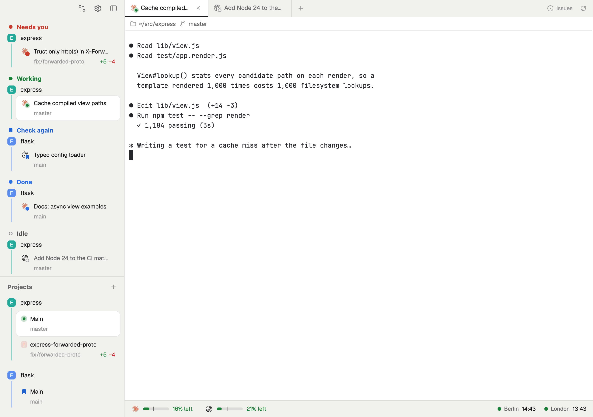
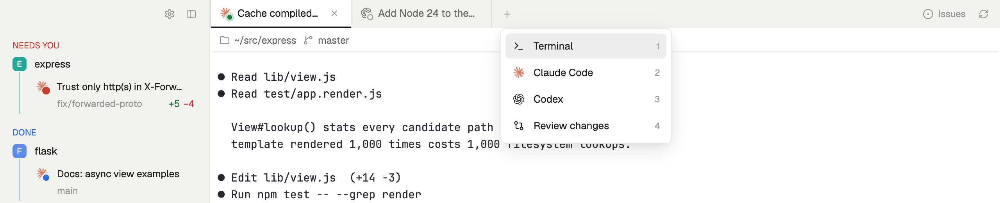
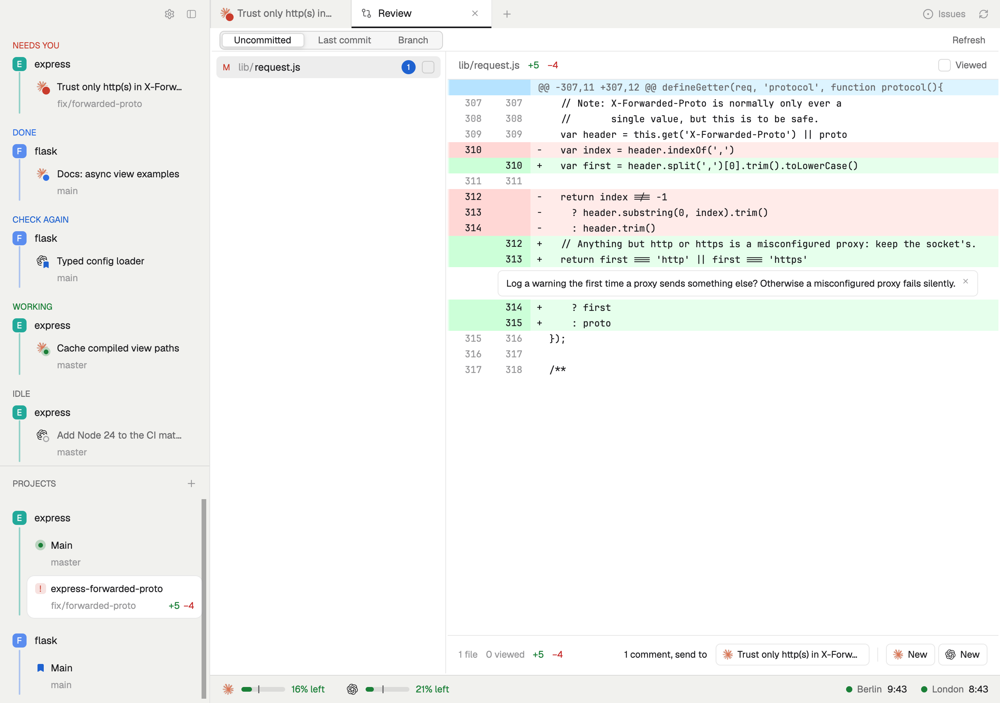

# metro

A layout for the [Herdr app](https://herdr.dev) for running many coding agents at once. The sidebar shows who needs you, what finished and what's still working, and every project's worktrees, each on a colored line with a stop per checkout, like a metro map. A full-tab review sends comments on a diff straight to an agent.



## What you get

**Agents, by what they need from you.** The sidebar's top half sorts every agent into Needs you, Working, Check again, Done and Idle, each grouped under its project. A badge on the agent's logo shows its state: red when it's waiting on you, blue when it finished, a breathing green dot while it works. Mark a finished agent **Check again** and it keeps a bookmark until it works again, even across restarts.

**Projects as lines.** Below, each repo is a line in its own color. Its stops are the main checkout and every worktree, with the branch under each. Worktrees with nothing open stay listed, below the open ones, so you can open them again. Pin a project to keep it when everything in it is closed, drag projects to reorder them, double-click to rename. **+** starts a worktree from a picker of the repo's open pull requests and branches, forks' PRs included.

**A tab bar that knows the branch.** Next to the tabs: how far the branch is behind `origin`'s default branch, its pull request colored by state with approvals and requested changes, and the issue the branch is named after (`fix/312-…`). One click opens each on GitHub. **+** opens a terminal, a new Claude Code or Codex, or the review, in the project you're in.



**Every project at once.** The grid button above the sidebar, or cmd-p, swaps the work area for a card per project: each worktree, open or not, with its branch, what's not pushed or committed, and its tabs with their agents' state. The worktrees you showed last sit in a row on top. Drag cards to arrange them, double-click a name to rename it, click a worktree or tab to go there. A worktree whose pull request merged says so, with a button to remove it.

**Pull requests, yours and the ones waiting on you.** A button above the sidebar, with a blue dot while a review request is new, swaps the work area for every open pull request you wrote and every one asking for your review, across GitHub. Each shows who reviewed as avatars badged approved, changes requested or commented; select one to mark it seen and see whose approval it still needs, its checks and conversation, open it on GitHub, or review its changes in a worktree with a review tab. An optional rule says whose approvals a repo needs ("ana, and bo or cy"), and shows Approved or 1 of 2. Its Issues tab lists the issues on your organizations' project boards that are in Estimation, New Week, This Week or In Progress and are yours or no one's; pick one, keep or edit the branch name it suggests (`fix/331-invoice-rounding`, or the issue's branch when there is one), and Start work opens a worktree on it, or Start with Claude Code opens Claude Code there on the issue; Assign me and Move to In Progress are buttons of their own. An approval, a request for changes or failing checks on one of your pull requests shows as a toast and a dot until you look. On your own pull request, Fix with Claude and Address with Claude hand failing checks or requested changes to Claude Code in its worktree. It needs `gh auth refresh -s project` once.

**Review before you merge.** **+ → Review changes** opens the diff as GitHub draws it: uncommitted, the last commit, or the whole branch. Search every changed line and see the matches file by file, as Zed's project search does, with next and previous. Comment on a line, a range or a hunk; comments stay in place while the agent keeps changing the file. Send them to an agent already in that project, or start a new Claude Code or Codex with them as its first message.



**A status bar for your week.** How much of this week's Claude and Codex usage is left against an even daily budget, and clocks for the places your team works, with a dot while it's working hours there.

## Install

```sh
git clone https://github.com/am-on/herdr-metro.git
cd herdr-metro
cp layouts/metro.json ~/.config/herdr-app/layouts/
cp -R mods/metro-* ~/.config/herdr-app/mods/
herdr-app do layout.switch --name metro
```

Herdr picks the files up while it runs, and `ctrl-shift-l` switches back to your previous layout. metro follows your theme; the screenshots use the light one. To switch to the agent view with `cmd-shift-a`, add this to `~/.config/herdr-app/keys.json`:

```json
"layout:metro": { "cmd-shift-a": "metro-tabs.view" }
```

It expects [`gh`](https://cli.github.com), signed in, for pull requests, issues and the worktree picker.

### Usage

The status bar reads Codex usage from `~/.codex/sessions` as it is. Claude Code only hands its limits to a [status line](https://docs.anthropic.com/en/docs/claude-code/statusline) command, so add this to yours (it needs `jq`):

```sh
input=$(cat)
limits=$(echo "$input" | jq -c 'if .rate_limits then {at: (now | floor), limits: .rate_limits} else empty end')
[ -n "$limits" ] && mkdir -p ~/.cache && printf '%s' "$limits" > ~/.cache/claude-rate-limits.json
```

### Clocks

The clocks show nothing until you name your places in `~/.config/herdr-app/metro-clocks.json`:

```json
{
  "hours": [8, 17],
  "places": [{ "name": "Berlin", "winter": 1 }, { "name": "New York", "winter": -5, "summer": 0 }],
  "meetings": [{ "name": "Standup", "place": "Berlin", "day": 1, "hour": 10, "minute": 0, "minutes": 15 }]
}
```

`winter` is the place's offset from UTC in winter, and `summer` the hours it adds during EU summer time (1 unless you say). `hours` are working hours, Monday to Friday. A meeting's `day` is its weekday, 0 for Sunday; on that day the bar counts down to it.

### Logos

Herdr draws its own Claude and Codex icons. For the logos in the screenshots, add to `~/.config/herdr-app/programs.json`:

```json
{ "programs": {
    "claude": { "icon": "mods/metro-chrome/icons/claude.svg", "tint": false },
    "codex": { "icon": "mods/metro-chrome/icons/openai.svg", "tint": true } } }
```

## Screenshots

The screenshots come from a demo window, not anyone's real work: `scripts/demo.sh` opens a second Herdr window with its own home, herdr-core session and `HOME`, clones express and flask, starts made-up agents in every state and seeds made-up usage. Your own window and terminals are never touched.

```sh
scripts/demo.sh         # open it
scripts/demo.sh shoot   # save preview.png, layouts/metro.png, docs/review.png and docs/new-tab.png
scripts/demo.sh stop    # close it and delete its folder
```

## Credits

metro started from [herdr-t3](https://github.com/JinJieBeWater/herdr-t3) and Herdr's own mods, both Apache-2.0. It has its own design now, and much of their code is still in it.

## License

Apache-2.0, see [LICENSE](LICENSE). [RECIPE.md](RECIPE.md) is the brief to build metro again from scratch.
