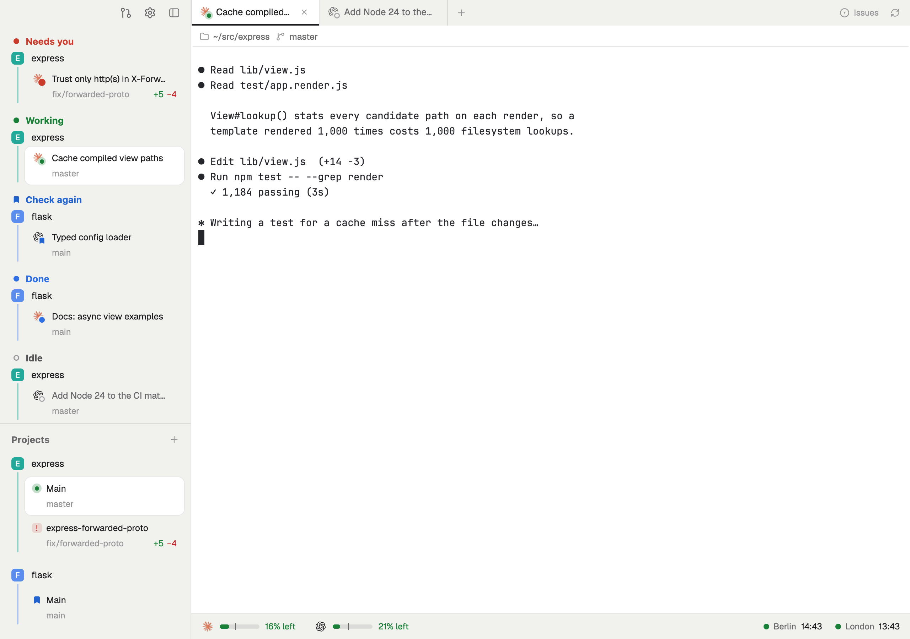

# metro

A quiet, light layout for running many coding agents at once. The sidebar sorts every agent by what it needs from you and draws each project's checkouts on a colored line with a stop per worktree, like a metro map. The tab bar knows the branch's GitHub state, a full-tab review sends diff comments to an agent, and the status bar paces the week's Claude and Codex usage.

This file is the brief: enough to build metro from an empty folder. The files next to it are one build of it. If they don't work on your Herdr, or you want it different, build it again from here.

## What you see

No system title bar. A 268px sidebar on the left runs the window's full height; the work column fills the rest. Everything is drawn in the person's own theme colors (the screenshots use `paper`); text in the UI font at 11–13px.

**The sidebar** (`chrome` background), top to bottom:

1. **Brand bar**, 36px: room for the macOS window buttons, then 30px buttons with 17px icons in `muted` (black on hover): Back and Forward (the tabs you showed, and the pull requests view, as a browser walks pages; dimmed with nowhere to go), a 16px line, Pull requests (a 7px `accent` dot, no number, while a review request is new; a white card while its view shows), Settings (a dot when an update is ready) and the sidebar toggle. Dragging it moves the window.
2. **Agents**, the top half. No heading. Sections titled in 13px bold Title case, each in its status color after its state's mark standing still (8px dot, ring or bookmark in a 14px column): Needs you (red dot), Working (green dot, not breathing), Check again (blue bookmark), Done (blue dot), Idle (dark grey text, `foreground` at 73%, grey ring), in that order: Done sits right above Idle, so an agent you've looked at drops to the next section. Under each title, agents are grouped under their project: the project's 18px colored avatar (its initial) and name, then the agents on a 2px rail in the project's color. An agent row is two lines: the agent's logo with its state as a badge, the task (the tab's name), then the branch, dim, with the same marks at its right as its checkout's row under Projects when the agent is on that checkout's branch. The agent on screen is a white card (`background`, 1px `border`).
3. **Projects**, the bottom half, under a "Projects" heading in 13px bold grey with a + on the right, the first project right under it. Each git repo is a project: its avatar and name, then its checkouts on the rail. A checkout row is two lines: a status mark and its name ("Main" for the main checkout, else the worktree's folder name), then its branch and, at the right, what isn't on origin: ↑ for commits on no remote (a branch never pushed counts too; not a fork's PR, `pr/<n>`, nor a branch whose upstream was deleted after merging; "3 commits not pushed" in its tooltip) and ↓ for commits to pull from its upstream, both in the text's grey (`muted`); when it's both because the branch was amended or rebased since its push (its upstream's tip is in the branch's reflog), only the ↑, its tooltip saying to force-push; then its uncommitted lines (`+41` green, `−13` red; untracked files count every line, as in a review of Uncommitted; nothing when clean). Checkouts with nothing open are listed too, without a mark, under the open ones. Spaces outside any repo are grouped under their folder as a project. Projects with nothing open, kept by a pin, sit below the open ones in the same colors, avatar and name, without a mark.

Both lists have an always-visible 10px scrollbar. Rows keep a transparent 1px border so nothing moves on hover; a hovered row becomes a white card with a mid-grey (`dim`) outline.

**The work column**, top to bottom:

1. **Tab bar**, 36px. Flat tabs 180px wide: the agent's logo with its state badge, the tab's name, a dark underline under the active one, × on hover. A + after the last tab opens a menu: Terminal, Claude Code, Codex, Review changes. On the right, for the focused checkout: how many commits it is behind `origin`'s default branch (amber), its pull request number colored by state (open green, draft grey, merged purple, closed red) with ✓ approved, ✕ changes requested or a speech bubble for comments, the issue named in the branch (`fix/312-…`) or else the repo's Issues link, then a refresh button.
2. **The tab's panes**, edge to edge with square corners and 8px between panes. Every pane, even a lone one, has a 28px header: its icon (with the state badge), and for a terminal alone in its tab only what the tab doesn't say: its folder (`~/src/express`) and branch. Split, zoom and close buttons appear on hover. A stack lets the same area show one agent full size instead (the agent view), or the pull requests, split in two and drawn in GitHub's own colors rather than the theme's (Primer: light `#ffffff` with `#f6f8fa` headers, `#d1d9e0` borders, `#59636e` grey, the selected row `#ddf4ff`, a `#1f883d` button; dark `#0d1117` and its equivalents, by appearance). On the left, a list 400px wide (drag its right edge: 260 to 720px, kept) under "Updated 18:06" and a refresh button: two sections, each headed by a 44px grey bar between lines, as GitHub heads a list: 16px sentence case and a count in a pill, Waiting on your review (its count white on red while there are any) and Your pull requests. Rows are split by hairlines. A row is two lines: a pull request icon (green; a grey draft icon for drafts) and the title, then the repo and number, Draft, the approval label (below), up to five reviewers' 20px avatars, each with their verdict as a badge in a notch at its bottom-right corner (green ✓ approved, red ✕ changes requested, grey commented, an amber ring for a review requested and not given), the checks (✓ green, ✕ red, a dot amber while running) and the age (`5m`, `3h`, `7d`, `2mo`). The selected row is light blue with a 3px blue bar on its left; a hovered one grey. On the right, the selected pull request, at most 900px wide, headed, without a frame, by: the repo and age (`rails/rails · 9h ago`), Hide at the right; the title at 32px, the main thing, then its number in grey and an external-link icon (click it for GitHub), both following the title's last word when it wraps; GitHub's 32px state label (white on `#1f883d` Open, white on grey Draft), then "**ana** wants to merge 4 commits into main from fix/login", the author bold, the branches 12px terminal-font pills in blue on `#ddf4ff`, then a button that copies the head branch's name and shows a green check for 1.5s; a line; one row of facts, the approvals ("0/2 approvals" under a rule, else "1 approval" or "No approvals", "Changes requested" in red when anyone asked for changes), the files and the lines (`+2,047 −557`); a line; Review status, "0 of 2" (or "1 approval") at its right, then each group of the approval rule as who approved for it (their avatar badged ✓, "Approved") or a clock and who is still needed ("Required", or "One approval required" for a choice), then everyone else who reviewed, commented or was asked, with their verdict ("No reviews yet." when there's nobody); Checks, only when the pull request has any, drawn at once from the list's overall state ("Passed", "Running" or "Failed" at its right) with one "Loading the checks…" row holding the place, then "Passed", "2 running" or "1 failed", the ones failing or still running by name, then "and 6 passed, 2 skipped"; and last one dark pill button of a fixed width, Review locally (check it out in a worktree and open a Review tab). A line, then the Conversation, newest first: each comment or review in a bordered box under a header (who, "commented", "approved" on green, "requested changes" on red, when), its text as markdown, and a review's comments on files with the file and line in the terminal font.
3. **Status bar**, 36px, under the work column only: Claude and Codex usage on the left, clocks on the right (440px).

## How it behaves

Agent states, the same everywhere a logo appears (tabs, agents list, pane headers): a 12px notch cut into the row's background at the logo's bottom-right corner holds

| State | Badge |
| --- | --- |
| working | a green dot (`ansi2`) whose halo breathes 6↔12px every 1.8s |
| blocked (needs you) | a red dot |
| done (finished, seen or not) | a blue dot |
| idle | a grey ring |
| Check again | a blue bookmark |

Project and checkout rows have no logo, so they use full-size marks in a 14px column 6px before the name: a 6px dot with a 6↔14px halo for working, a red "!" tile for blocked, a blue dot for done, a grey ring for idle, the bookmark for Check again. No agents, no mark.

- **Check again**: click a done or idle agent's badge (or the bookmark shown on hover) to mark it; it moves to the Check again section with a bookmark until it works again or you click the bookmark. It is the terminal label `metro.check=1`, so it survives restarts.
- **Agents list moves**: when an agent changes section (done to idle, working to needs you), its row slides to its new place in 260ms (ease-in-out) and everything between slides to make room; a heading, project title or rail that's no longer needed fades out where it was (180ms), and a new one fades in once the slide is nearly over, so nothing shows over a box still moving. A finished agent stays in Done while it's focused or the pointer is on one of the list's rows (say, the agent you clicked next), and drops to Idle one second after both end, so the row under the pointer never shifts. That covers one you look at (done turns idle) and one that finishes on screen (Herdr goes straight from working to idle, so the list treats that change as finished). The list publishes the agents it holds in shared `agents.finished`, and tabs, pane headers and Projects rows show them as done too. It only renders while the sidebar shows: with it hidden, nothing new is held, and one already held stays blue until the sidebar is back.
- **Agents list**: click a row to show that agent. Hover shows a pin (pinned agents get their own section first) and an × that closes the agent's pane. Under the agents, Reviews (every review tab: its name, then what it compares and its file count, `+`/`−` at the right) and Terminals (every terminal that isn't an agent: its program or title, then its branch or folder), grouped by project as the agents are; click one to show its tab, hover for an × that closes it. Idle and Terminals show their first five; a section's count, ringed, appears only past five. Clicking a section's heading does nothing. Agent order follows the list (`setAgentOrder`), so next/previous agent keys walk it top to bottom.
- **Projects**: click a checkout to open or show its space. Hover a project for: fold, pin (keep it listed when nothing is open), + (new worktree, or a new space for a folder project), × (close its spaces; Herdr asks). Hover a space for its own ×, which closes it; a worktree's ×, open or closed, asks once before closing its space and removing it (right-click → Close keeps the worktree): "Remove <name>?" under a trash icon, the folder that will be deleted, each risk (uncommitted changes, open agents, unpushed submodule commits) in a red box (while it checks, a box of the same size says so and Remove waits dimmed; a clean worktree's says "No uncommitted changes."), and Cancel and a red Remove worktree button, each with its key (`esc`, `↵`) in a small label. Double-click a project's name to rename it; drag projects to reorder them; click the avatar for a nine-color picker.
- **New worktree** is a picker: the repo's open pull requests (`gh pr list`), then its local and remote branches, newest first, filtered as you type (title, branch, author, `#330`, a PR URL), then "Create <name>". A branch already checked out jumps to its space; a fork's PR becomes `pr/<n>`. Pull requests arriving after you've moved through the list don't move the highlight off the row it's on. Under the list are Cancel `esc` and a solid Create worktree `↵` button, each with its key in a small label: Open worktree when the highlighted branch is already checked out, dimmed when nothing is highlighted.
- **Tab bar**: the behind count, PR and issue each open on GitHub; GitHub state refreshes every three minutes and with the refresh button (which spins, and turns red with a tooltip when `origin` can't be fetched). cmd-shift-a switches to the agent view; a stacked icon in the tab bar leads back.
- **Pull requests** (the brand bar's button, again to go back): every open pull request you wrote, and every one asking for your review, across GitHub. Click a row (or arrow keys) to show it on the right; double-click or Enter opens it on GitHub. Its conversation and checks load when it's selected ("Loading the conversation…"), again once it changes; avatars download once. Review locally shows its checkout: the space where its branch is checked out, else a new worktree space for it (a fork's as `pr/<n>`), fetched every time and moved to the pull request's latest push, a force-push included, unless that would lose work (uncommitted changes, or commits that were never on a remote; a fork's force-pushed commits count as those), then a Review tab on its branch (or the space's Review tab); when it couldn't be moved, or origin couldn't be reached, the review opens anyway with a warning toast, and the reason stays in amber under the button; a repo not here yet shows a card under the button instead, "express isn't in your projects yet": Use `~/src/express` (dark, only when a folder of the repo's name beside your other repos or in home is a clone of it), Clone… (the system's picker for where, then `gh repo clone`, a spinner while it runs) and Open existing folder… (the picker; a clone of that repo is required). A clone counts when its origin is the repo, by name or by what GitHub calls that name now (`gh api repos/<origin>`), so one from before a move or rename does; a fork doesn't. Each adds it to the sidebar's projects (shared `projects.kept`, the least used color) and goes on with the review; what went wrong shows in red on the card, and any other failure in red under the button. A repo already listed under an old name needs no card. Hide puts it away until it closes (shared `metro-prs.hidden`); a section's hidden ones fold into a dim "2 hidden" row under it, unfolded at 55% opacity, where the button reads Show again; the brand bar's dot leaves them out. A review request is new, with a 6px blue dot left of its row's icon, until its pull request has been selected with the view on screen, the one selected on opening included; your own comments and pushes don't bring it back, a new request for your review does (shared `metro-prs.seen` keeps the time of the request seen). Section counts are always grey. A row marks its checks only when they failed or are running; passed shows on the right, as a green check beside the avatars would read as an approval. **Approval rules**, from an optional `metro-prs.json` in Herdr's folder, `{ "approval": [{ "owners": ["acme"], "need": [["ana"], ["bo", "cy"]] }] }`: in a listed owner's repos a pull request needs an approval from someone in every group; all met is a solid green "✓ Approved" label, some a light "✓ 1 of 2", and the Review status card lists who approved for each group and who each missing one needs; an invalid file shows its error in red over the list. Selecting a space, an agent, a tab or a new pane leaves the view; the tab bar names it while it shows and has the stacked icon back to the tabs. It looks again every three minutes, the brand bar's dot too.
- **Review** (+ → Review changes) is a full tab laid out as GitHub's unified diff: file list on the left, old and new line numbers, changed words highlighted, long lines wrapped. Its pane header is its toolbar: Uncommitted, Last commit or Branch (against the merge-base with `origin`'s default branch), then what that shows as GitHub counts it (`3 files +2,500 −300` and five squares split green and red, an untracked file counting all its lines), and Refresh. The footer says how many of the files are viewed (`1 of 3 viewed`). Right-click a file in the list, or the open file's path above its diff, for a menu: Copy path (the absolute path) and Open on GitHub (the file on the checked-out branch when origin has it there, else on the default branch; the branch named at the right, "Not on GitHub yet" dimmed when neither has it). Click a line, shift-click a range or click a hunk's `@@` header to comment in a box that wraps long lines and grows to ten, the posted comment's own 560px card, so its text stays where it is once posted (`↵` adds the comment, shift-`↵` a new line; under the box the lines it covers and those hints, then Cancel `esc` and Comment `↵` buttons, each with its key in a small label; Save when editing one); comments are drafts shared by every review of that repo until sent, and each follows its line as the file changes. A search box over the file list (cmd-F) looks through every changed line, new files included, case-insensitive: the list keeps the files with a match, each with its count, and the diff gives way to every match in one list, as Zed's project search shows them: each file a white card on the sidebar's grey (`chrome`, 12px around it), as the sidebar's shown agent is: a 1px border, 6px corners, its last line followed by 9px of white before its rounded bottom, on top, over a line, a white bar with a file icon, its folder, its name in bold and its count in a pill then the two lines around each match, a ⋯ where lines are skipped, matches yellow and the current one orange. ↵ and shift-↵ (or the box's ↑↓, or cmd-G) go to the next and previous match, the box saying `3/12`; clicking a result or a file opens that file with only its hunks with a match, starting two lines above that match (or its first) with what's above folded into a "Show 147 lines above" row, and All matches goes back. Esc or × clears it. With comments, the footer lists the agents in that space, then New Claude Code and New Codex: clicking one sends them all at once, pasted into the agent or as a new agent's first message.
- **Usage** shows each provider's weekly limit against today's share of it, the week split evenly over its workdays (20% by Monday night, 40% by Tuesday …): "x% left" (amber under 3%) or "x% over" (red). Click for details.
- **Clocks** show each configured place's time with a green dot during working hours (a grey ring otherwise) and, on a meeting's day, a countdown to it (amber in its last 15 minutes).

## Built from

- **The layout** (`layouts/metro.json`): a root `row` with `"titlebar": "none"`, `"traffic_lights": [16, 11]`, `terminal_padding: [8, 0]`, a 1px `border` divider and no theme of its own. Children:
  - `sidebar`, a `column` (268px, min 180, max 480, `chrome`, not resizable): `brand` (block, 36px, `metro-chrome`, `window_drag`), then `lists`, a `column` with a 1px divider: `agents` (`metro-agents`) and `spaces` (`metro-spaces`), equal weights, min 90 each.
  - `work`, a `column`: `tabs` (block, 36px, `metro-tabs`, `window_drag`); `work-body`, a `row` holding `view`, a `stack` of `main` (`{ tab: "active", pane: { header: { content: { mod: "metro-pane" }, reveal: "always", height: 28 }, radius: 0, gap: 8, lone: true, border and focus 2px in background } }`), `agent` (`{ agent: "focused" }`) and `prs` (`metro-prs`, `background`); then `status`, a 36px `row` of `metro-usage` and a 440px `metro-clocks`.
- **Mods** (`mods/metro-*`): `metro-chrome` (brand bar; also holds every icon the others use, in `icons/`), `metro-agents`, `metro-spaces`, `metro-space-color` (the color popup), `metro-worktree` (the picker, a dialog), `metro-tabs`, `metro-new-tab` (the + menu, a popup), `metro-pane` (pane header), `metro-review` (a mod pane opened with `tab.new { mod, props: { folder, space, machine, mode? } }`), `metro-prs` (the pull requests view), `metro-usage`, `metro-clocks`. `name.js` (what a terminal is working on: a named tab, else a telling title, else the program) is copied into each mod that names agents.
- **Shared state**: `space.colors` (project colors by space id, a theme name or `#hex`), `projects.kept`, `projects.names`, `projects.order`, `projects.of` (which project each space is under, published by `metro-spaces` for `metro-agents`), `projects.git` (each space's branch, commits to push and pull, whether it was amended, and uncommitted lines, published by `metro-spaces` for `metro-agents` when they change), `agents.pins`, `metro-review.drafts` (by `<machine>:<repo root>`), `metro-review.<tab>` (a review's state for its header), `metro-prs.new` (how many review requests are new, hidden ones left out, for the brand bar), `metro-prs.seen` (URL of each pull request asking for your review -> the time of the request seen, forgotten once it stops asking), `metro-prs.hidden` (URLs of pull requests hidden, forgotten once closed).
- **Data and commands**: `agents()`, `spaces()`, `panes()`, `terminals()` (labels), `focused()`; `agent.focus`, `space.select`, `space.new`, `space.close`, `tab.new`, `tab.close`, `pane.close`, `layout.select` (the agent and pull requests views), `setAgentOrder`. A review's toolbar clicks reach it as `run("metro-review.<command>")`, read with `nextCommand()`.
- **Programs it runs**: `git` (worktrees, branches, diffs, behind counts, `fetch --prune`), `gh` (`pr view`, `pr list`, `issue view`, and `api graphql`: searches for `author:@me` and `review-requested:@me` with when each review was requested, and one pull request's reviews, comments and checks), `curl` (reviewers' avatars, from the `avatarUrl` GitHub gives, to `data/metro-prs/avatars/`), `hc label` (Check again), `hc send` (sending review comments).
- **Files it reads**: `~/.cache/claude-rate-limits.json` (written by a Claude Code status line command from the `rate_limits` it's given), the newest `rate_limits` line in `~/.codex/sessions/**/*.jsonl`, and `metro-clocks.json` in Herdr's folder (`{ hours, places: [{ name, winter, summer? }], meetings: [{ name, place, day, hour, minute, minutes }] }`; without it the clocks show nothing).

## Watch out

- Keep the pane header always shown (`reveal: "always"`): the review pane's header is its toolbar, and a hover header covers the terminal's first line.
- `theme().selected` and `theme().hover` are see-through; painting them on a row that already has them darkens it. Use solid `background` for the shown and hovered rows.
- A `.hover()` style can't change a border color: track the pointer with `.on_hover` and style the row from that state.
- `render` must not call `cx.notify()`; react to another mod through `run("<mod>.<command>")` and `nextCommand()`, not by watching shared state in `render`.
- A checkout's `origin/HEAD` is written at clone and never follows a renamed default branch. Ask `git ls-remote --symref origin HEAD` for the review's base and the tab bar's behind count; the local ref only stands in offline.
- A mod pane isn't told its pane or tab id. The review remembers its tab per copy in `localStorage`, claimed from the focused pane when it starts.
- A mod opened in a tab just created in another space still sees the old space as active for a moment: pass the space and folder in its props.
- The UI font, Geist, has one weight, so `font_weight` does nothing on it. The bold headings use the system font: `.font_family(".SystemUIFont").font_weight(700)`.
- Herdr has no layout animation: a flex column redraws a moved row in its new place at once. The agents list places every box itself (`absolute().top(y)`, heights from `on_size_change`) with a key that stays the same across sections (`ag-<address>`, `head-<section>`), and `.transition("top", …)` on each slides it. A box keeps its transition state by id, not by its place among its siblings. New boxes are drawn once at opacity 0 and set to 1 on the next render (a 20ms `cx.timer.after`); removed ones are kept, fading, until their fade ends. Boxes are opaque in `chrome` and agents are drawn last, so a heading sliding past a row goes under it.
- `v_virtual_list` drew nothing inside a row here; it draws inside a `div().h_full()`, as Herdr's Changes panel has it, which the review's search results use (fixed heights: one-line rows, clicks through `on_item_click`, `scroll_to_item` for next and previous). The diff itself is a plain scrolling column, as comments wrap to any height.
- The UI font has one weight, `toLocaleTimeString` ignores its options (format times by hand), and accessibility roles use gpui's snake_case names (`check_box`).
- Project colors need about 2.5:1 contrast against `chrome` to read on the rail; a pale yellow doesn't, whatever its outline.
- Herdr checks for installed agents with a non-login shell; give Homebrew programs a full path in `programs.json`.
- Icon paths are `mods/metro-chrome/icons/…`; renaming that mod means renaming them everywhere.

## Done when

- Every agent appears once in the agents list, in the section of its state, under its project, with the right badge; marking one Check again moves it to that section and the bookmark shows in its tab and pane header too.
- An agent whose state changes slides to its new section rather than jumping; a burst of `herdr-app shot` frames shows it between its old and new place.
- Every checkout of a repo appears under its project, open ones with their mark, closed ones without, in the same colors, and clicking a closed one opens a space there.
- On a branch with an open pull request, the tab bar shows its number in green with the reviews' marks; on the default branch the behind count and PR are hidden.
- + → Review changes on a dirty checkout shows the diff; a comment on a line, sent to New Claude Code, opens a tab whose first message quotes that line.
- With `metro-clocks.json` naming two places, both show their time and the right dot.
- `herdr-app check` passes for every `mods/metro-*`, and `herdr-app status` shows no errors with the layout on screen.
